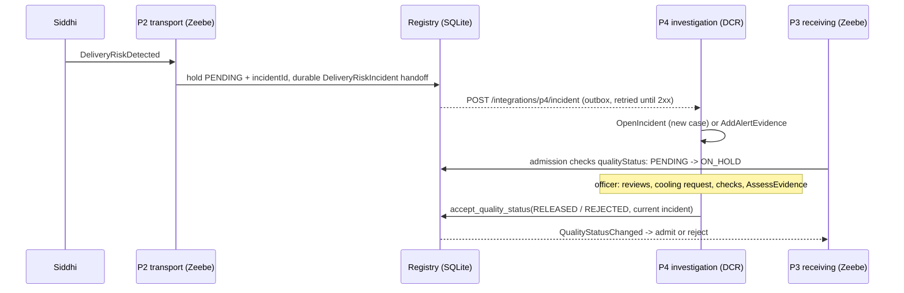

# P4 — Quality incident investigation (DCR)

**Owner:** Abid Hasan (claimed with this PR; the task board records the team's confirmation) · **Model:** [`dcr/p4_quality_investigation.xml`](../dcr/p4_quality_investigation.xml) ([PDF](../dcr/p4_quality_investigation.pdf), [AS-IS BPMN PDF](../dcr/p4_as_is.pdf)) · **Code:** [`deployer/quality.py`](../deployer/quality.py), [`deployer/dcr_client.py`](../deployer/dcr_client.py) · **Evidence:** [`compliance/p4/`](../compliance/p4/)

## What P4 does

When P2 accepts a delivery risk (or Siddhi reports a temperature excursion), the shipment is put on **quality hold** and P4 opens an investigation case in DCR. The investigation is knowledge-intensive: the quality officer collects evidence in whatever order the case needs, while DCR enforces the few rules that must always hold. The officer's decision is the only thing that lifts or confirms the hold: **release** lets P3 admit the goods; **replace** or **return** rejects them (P5's corrective fulfilment is still planned).

The AS-IS process (assumed coursework scenario, not interview data) is in [`dcr/p4_as_is.pdf`](../dcr/p4_as_is.pdf): temperature data is read after the trip, goods go straight into stock, evidence is collected by phone/e-mail and the decision is not recorded.



## Rules (R1–R9) and the graph

16 activities in three nesting groups (Investigation, Requests, Decision), 34 drawn arrows = 83 flat relations, only the five lecture relations (condition, response, include, exclude, milestone). Initially `OpenIncident` is pending; acknowledgement, failure, recovery evidence and the additional check are excluded until a request includes them.

| Rule | Meaning | Activities (role) |
| --- | --- | --- |
| R1 | The integration service opens the incident once; nothing happens before | `OpenIncident` (Integration) |
| R2 | Further alerts are added as evidence; each requires a new assessment | `AddAlertEvidence` (Integration) |
| R3 | Reviews in any order, repeatable; weather and route/ETA are optional | `ReviewTemperatureLog`, `ReviewWeatherData`, `ReviewRouteAndETA` (QualityOfficer) |
| R4 | Assessment only after the temperature log was reviewed (a delay alone proves nothing) | `AssessEvidence` (QualityOfficer) |
| R5 | A cooling request must be answered (acknowledged or failed); no closure while outstanding; a failure does not count as completed | `RequestCoolingAdjustment` (QualityOfficer), `RecordCoolingAcknowledgement`, `RecordCoolingFailure` (Integration) |
| R6 | Recovery evidence only after a successful acknowledgement; it must be assessed and never releases goods by itself | `RecordRecoveryEvidence` (Integration) |
| R7 | A requested check must be completed by the receiver; while outstanding no assessment, decision or closure | `RequestAdditionalCheck` (QualityOfficer), `CompleteAdditionalCheck` (Receiver) |
| R8 | After assessment exactly one decision; afterwards no new checks or cooling requests | `DecideRelease`, `DecideReplace`, `DecideReturn` (QualityOfficer) |
| R9 | Every incident is assessed and closed; closing needs a decision; nothing after closing | `CloseInvestigation` (QualityOfficer) |

The graph is generated from one specification and checked exhaustively: all **3 425** reachable markings can still reach an accepting marking (no deadlock) and every activity can occur (`stage_tests/test_p4.py::P4Graph`).

## Rules enforced by the service, not by DCR

- The hold is recorded **before** the DCR case is created; if DCR is unreachable the hold stays (`DCR_UNAVAILABLE`) and the case is retried by the background loop.
- One active incident per shipment: P2 reuses the `PENDING` incident; P4 turns a repeated alert into `AddAlertEvidence`. An alert for a closed or `REJECTED` incident is recorded as `LateAlertEvidenceRecorded` and cannot reopen quality permission (agreement invariant 8).
- A decision needs a `reason`. It is applied through the shared `Registry.accept_quality_status` for the **current** incident only: `RELEASE → RELEASED`, `REPLACE/RETURN → REJECTED`. A decision for a superseded incident is recorded as `StaleDispositionIgnored`. If the registry write fails, it is retried (`dispositionApplied: false`).

## DCR engine

| Mode (`/health` → `integrations.p4DcrEngine`) | When | Notes |
| --- | --- | --- |
| `dcr-repository` | `DCR_GRAPH_ID`, `DCR_USERNAME`, `DCR_PASSWORD` set (untracked `.env`) | Executes in the dcrgraphs.net Active Repository via its REST API. **Not yet verified with the team account.** |
| `local-dcr-engine` | Otherwise (default) | Executes the same XML with flat DCR semantics (identical to `compliance/check.py`); each case's marking is stored in the registry SQLite file. |

To use dcrgraphs.net: import `dcr/p4_quality_investigation.xml` as a new graph, note the graph ID, copy `.env.example` to `.env`, fill in the three values, and rebuild (`docker compose up --build -d --wait`). Never commit `.env`.

## HTTP interface

| Request | Purpose |
| --- | --- |
| `POST /integrations/p4/incident` | P2's durable `DeliveryRiskIncident` handoff (`{"event": {...}}`, header `Idempotency-Key` = `event.deliveryId`). Exact retries return the same result; changed content → 409. Internal, unauthenticated demo route. |
| `POST /integrations/p4/temperature-excursion` | `eventId, shipmentId, occurredAt (UTC), source, inputMode, payload`. Places the hold (or joins the active incident), then opens/updates the case. For the future Siddhi temperature pattern; until then label inputs `simulated`/`manual`. |
| `GET /quality/incidents/<incidentId>` | Incident, decision and the DCR case's enabled/pending activities |
| `POST /quality/incidents/<incidentId>/activities/<Activity>` | `{"actor", "reason" (decisions), "note", "eventId" (optional, makes external inputs idempotent)}`. **409 with the `enabled` list when DCR does not enable the activity.** |
| `POST /quality/incidents/<incidentId>/sync` | Retry case creation / queued integration events / an unapplied decision |
| `GET /shipments/<shipmentId>/quality` | `qualityStatus`, `qualityIncidentId` and incident history |

Incident IDs contain `:` (for example `DELAY:SIDDHI:RISK:...`); URL-encode them in paths. In the demo menu (`tools/demo.py`), option **18** shows the case and executes an enabled activity; option **17** is the earlier test stand-in that bypasses P4.

## Evidence and checks

| Evidence | Where | Status |
| --- | --- | --- |
| Offline tests (P4 with the real P2/P3 registry code; Zeebe substituted) | `stage_tests/test_p4.py` | PASS |
| dcrgraphs.net simulator, 4 manual runs + blocked actions | `compliance/p4/dcrgraphs-simulation-log.xes`, `compliance/p4/screenshots/` | PASS (run 4 intentionally partial) |
| Synthetic forbidden traces (9) | `compliance/p4/invalid-traces.json` | all rejected |
| Live stack run (4 scenarios, P1→P2→P4→P3) | `stage_tests/check_p4_investigation.py` → `compliance/p4/execution-log.xes` | **pending** — see below |
| dcrgraphs.net API execution / ProcessDoctor | — | **pending** |

```bash
.venv/bin/python -m unittest discover -s stage_tests -p 'test_p4.py' -v
.venv/bin/python compliance/p4/build_p4_evidence.py            # rebuilds verification.json
.venv/bin/python compliance/check.py compliance/p4/dcrgraphs-simulation-log.xes --model compliance/p4/rules.xml
```

The last command exits 1 only because run 4 is intentionally unfinished (`AssessEvidence`, `CloseInvestigation` still pending); runs 1–3 are valid and accepting.

**Live run** (fresh paired version-3 dataset, simulator on, default Compose settings), following the [run guide](RUNNING.md#automated-verification):

```bash
.venv/bin/python stage_tests/check_p4_investigation.py --base http://localhost:5001
.venv/bin/python compliance/p4/build_p4_evidence.py --live runtime/p4-compliance/evidence.json
```

Each scenario dispatches a real shipment, accepts a delivery risk, waits for P4 to open the case, receives and inspects the goods in P3 (which then waits `ON_HOLD`), executes the investigation, attempts forbidden actions (must be 409) and checks the final P3 outcome. The builder then writes `execution-log.xes` and the live section of `verification.json`.

## Still to do

- Run the live check above and commit its log/report (needs a machine with Docker).
- Verify `dcr-repository` mode with the team's dcrgraphs.net account; upload `rules.xml` + the live log to ProcessDoctor.
- Siddhi temperature-excursion/recovery patterns and the cooling-command bridge (shared CEP work); until then those inputs are manual/simulated.
- P5 consumes `REPLACE`/`RETURN` dispositions (planned).
